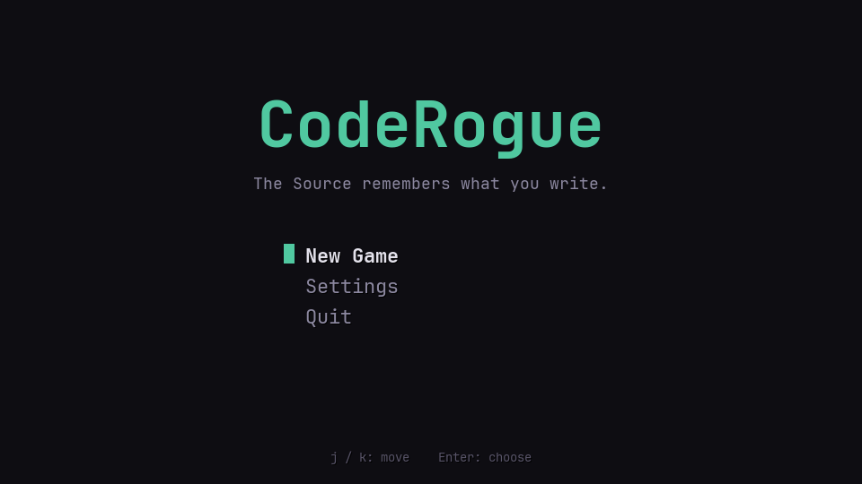
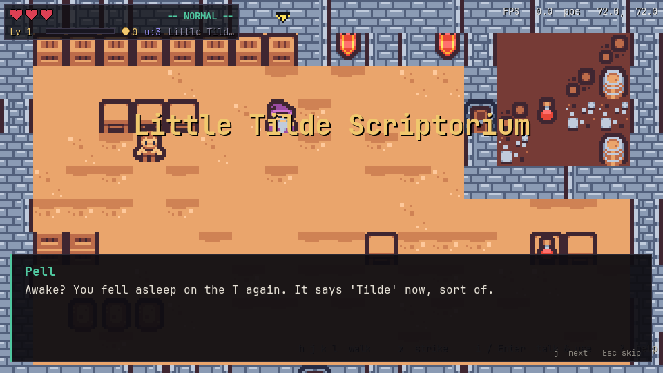
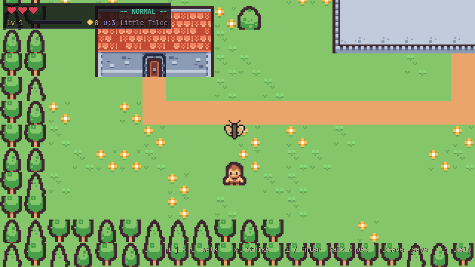
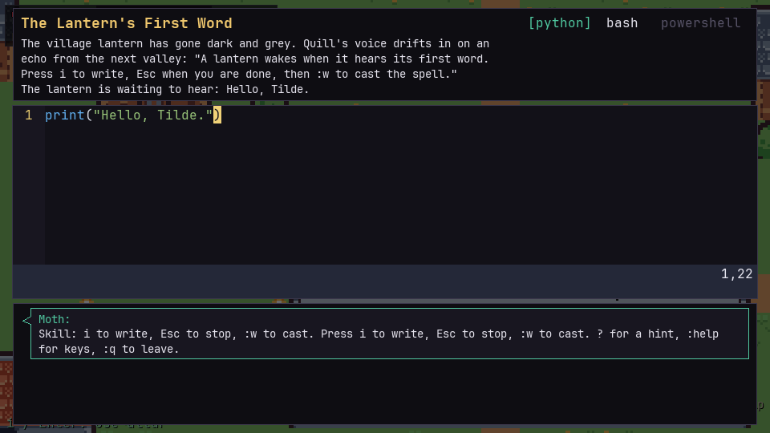
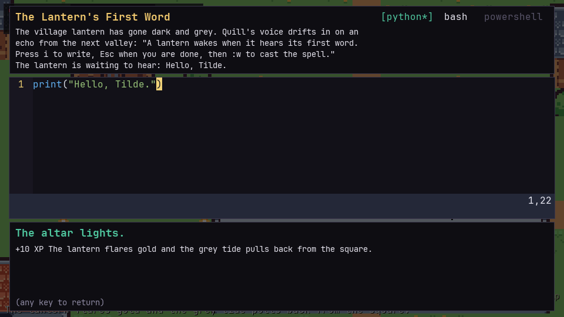
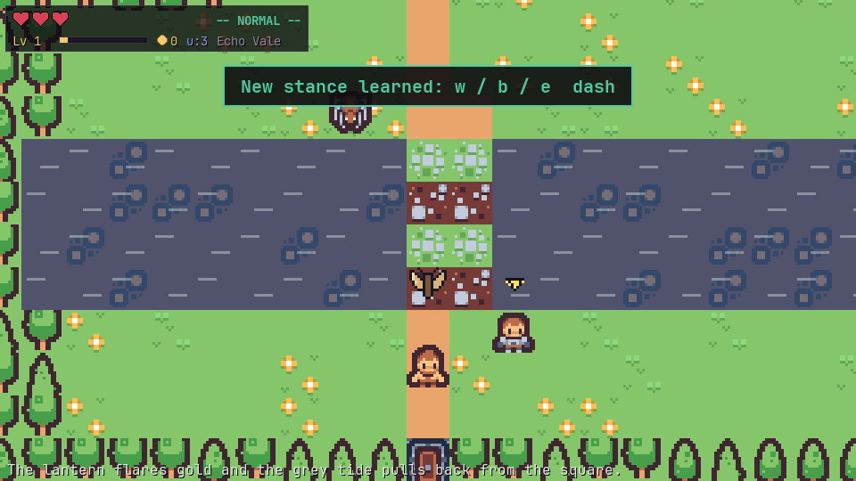
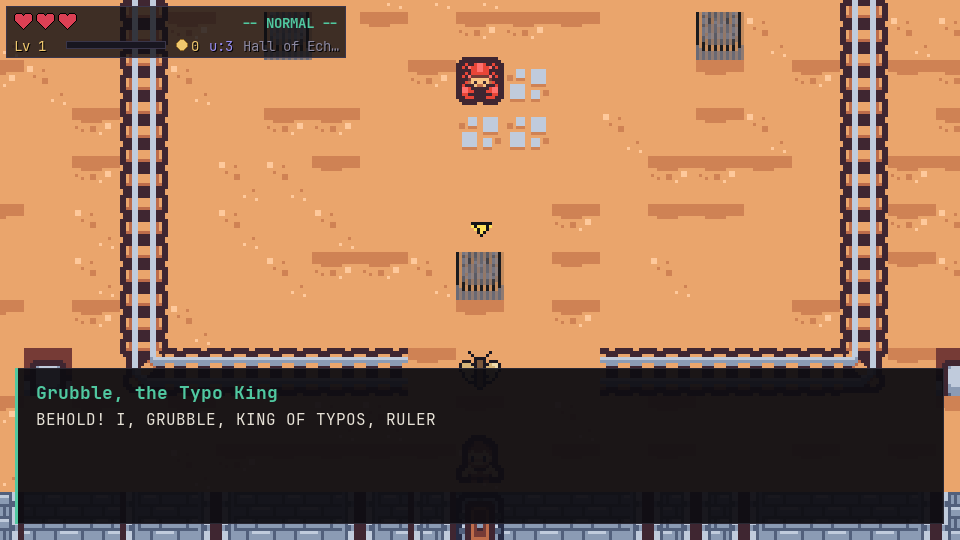
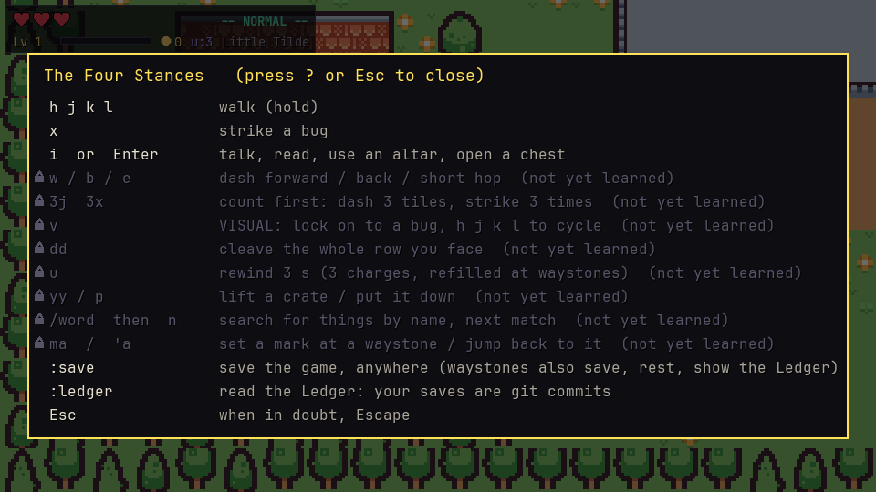

# CodeRogue

**An action adventure that teaches you to actually code. Move with VIM keys. Solve the world's problems in Python, bash, or PowerShell. No autocomplete, no assistant, just you and a blinking cursor.**



It has never been easier to get code written for you, and never easier to lose the ability to write it yourself. CodeRogue is for people who want the basics in their hands: what a variable is, how a loop ends, why a file has a newline at the end, what `git diff` is telling you. The kind of thing you should not need to ask anyone for, including a machine.

So it is a game. The kingdom of Shellmarch is written in the Source, and a corruption called the Null is emptying it line by line. Your teacher has been reduced to a single word, `None`. You are Wren, an apprentice with the home row under your fingers, and the only way forward is to write.

Three ideas hold it together:

- **Every key you learn for the world works in the editor.** `hjkl` walks and moves the cursor. `x` kills a bug and deletes a character. `dd` cleaves a row of enemies and deletes a line. By the end you know VIM because you played with it for hours, not because you memorised a cheat sheet.
- **The puzzles are real programs, run by a real interpreter.** You type the code. If it is wrong, you see exactly what it printed next to what was expected, and the error in plain words. Nothing is auto-filled.
- **It is a course in disguise.** The order is the order of an intro programming class: output, variables, arithmetic, input, conditionals, loops, lists, dictionaries, functions, files, pipelines. Saving the game is a git commit, so by Chapter 2 you are reading `git log` and `git checkout` for real.

## What it looks like

| | |
|---|---|
|  |  |
| *The first thing you learn is to walk with `h j k l`. The game never tells you to use the mouse, because there is nothing to click.* | *An overworld in the spirit of the Zelda games. Explore, fight bugs, find altars.* |
|  |  |
| *An altar is a coding problem. Press `i`, write the program in Python, bash, or PowerShell, and `:w` runs it. This is `print`. It gets harder.* | *Pass and the altar lights. Fail and you get the diff, the error in plain words, and three rungs of hints, never the answer.* |
|  |  |
| *Echo Vale, where the Null has eaten every name. Each chapter is one unit of the course.* | *Chapter bosses are a fight and a multi-part coding challenge at once. Grubble is defeated by debugging his proclamation and computing a census.* |



## What you learn

The chapters follow an intro programming course. The story is there so you keep going.

| Chapter | Where | Concepts | New keys |
|---|---|---|---|
| Prologue | Little Tilde | printing, sequencing, reading an error | `h j k l` `x` `i` `Esc` `:w` `:q` `:save` |
| 1 | Echo Vale | variables, arithmetic, input, strings, formatting | `w b e` `A o 0 $` |
| 2 | Branchwood and the Looping Mire | if/else, while, for, lists, filtering input | `v` counts `dd` `u` |
| 3 | The Grand Directory | dictionaries, functions, reading and writing files, pipelines | `yy p` `/ n` marks |

Every puzzle has a Python, a bash, and a PowerShell variant teaching the same idea. Pick one per puzzle, or solve it twice. Hints come in three rungs and the third is still not the answer. Coding is never timed. You can skip and come back, but the altar stays dark until you do it yourself.

Saving is a git commit. Set a seal at a waystone, or type `:save`, and the game commits your progress and your programs into a local repository it calls the Ledger. When the Null eats your work in Chapter 2, you get it back with `git log`, `git diff`, and `git checkout`, with the real commands on screen.

## Install and run

You need **Python 3.12 or newer** and **git** (for the Ledger; the game works without it, with plain saves).

```sh
git clone https://github.com/gabrielconlon/coderogue.git
cd coderogue
python3 -m venv .venv
source .venv/bin/activate          # Windows: .venv\Scripts\activate
pip install -e ".[dev]"
python tools/fetch_assets.py       # downloads Kenney's CC0 art packs (about 7 MB)
python -m coderogue
```

Useful flags:

```sh
python -m coderogue --new          # ignore the saved game and start over
python -m coderogue --arrows       # also bind arrow keys and WASD
python -m coderogue --doctor       # report which languages and assets were found
```

Languages are detected on your machine:

| Language | macOS | Linux | Windows |
|---|---|---|---|
| Python | yes | yes | yes |
| bash | yes (Homebrew bash preferred; stock 3.2 works through Chapter 2) | yes | with Git Bash |
| PowerShell | with `pwsh` | with `pwsh` | yes |

A puzzle only offers the variants your machine can run.

### Packaged builds

`python tools/build.py` produces a self-contained app in `dist/` with PyInstaller, including a bundled Python for player code. See [docs/PACKAGING.md](docs/PACKAGING.md). Prebuilt downloads will appear on the Releases page once the release workflow has run.

## Controls

Press `?` in the game at any time for the full list. Stances unlock as the story teaches them.

| Key | In the world | In the editor |
|---|---|---|
| `h j k l` | walk (hold) | move the cursor |
| `x` | strike a bug | delete a character |
| `i` or `Enter` | talk, read, use an altar, open a chest | insert mode |
| `w` `b` `e` | dash forward, back, short hop | jump by word |
| `v` | lock on to a bug | select text |
| `dd` | cleave the whole row you face | delete a line |
| `u` | rewind three seconds | undo |
| `yy` `p` | lift a crate, put it down | yank and put a line |
| `/word` then `n` | search for things by name | search |
| `:save` | save the game anywhere (waystones also save, rest, and open the Ledger) | |
| `:w` `:q` | | cast the spell, leave the altar |
| `Esc` | when in doubt, Escape | back to NORMAL |

## Player code and safety

Your code runs as a local subprocess with a timeout, a fresh temporary directory, a scrubbed environment, and output limits. On Linux and macOS it also gets CPU, file-size, and process limits where the OS allows. This protects against accidents such as infinite loops. It is **not** a security boundary: the code runs as you, on your machine, the same as running a script you wrote yourself.

## Contributing

Content lives in `content/` and needs no engine changes: puzzles are YAML, maps are generated from readable ASCII sources with `python tools/mapgen.py`, dialogue is YAML. Adding a language is one plugin module plus puzzle variants. See [docs/CONTRIBUTING.md](docs/CONTRIBUTING.md), [docs/ARCHITECTURE.md](docs/ARCHITECTURE.md), and the design bible in [docs/DESIGN.md](docs/DESIGN.md).

```sh
pytest                              # the test suite, headless
python tools/validate_content.py    # runs every puzzle's reference solution
```

## License and credits

Code is MIT. Art and audio are by [Kenney](https://kenney.nl) (CC0). The editor font is JetBrains Mono (OFL). See [CREDITS.md](CREDITS.md).
